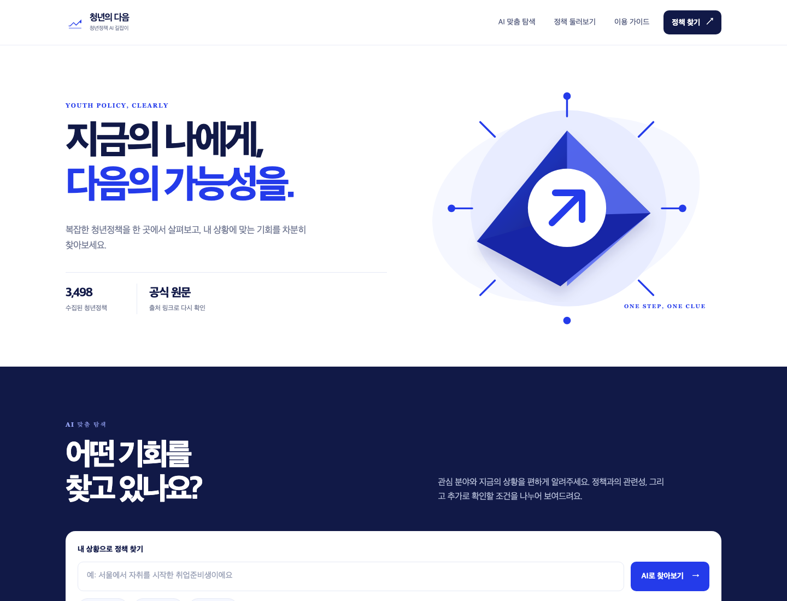
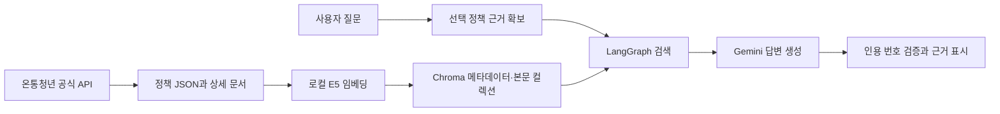
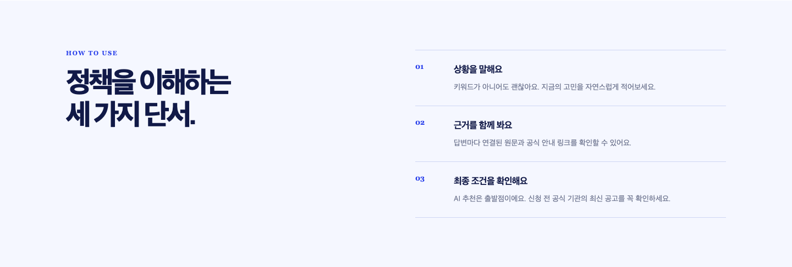
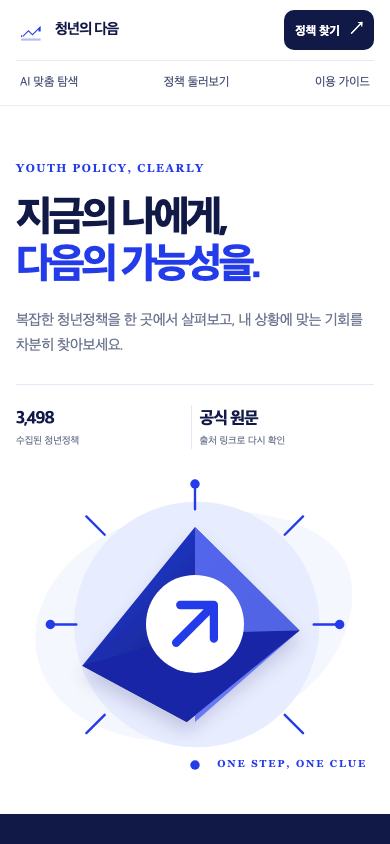

# 청년의 다음 · 청년정책 AI 길잡이

공식 청년정책을 찾아보고, 내 상황과 관련된 정책 후보를 탐색하며, 선택한 정책에 대해 **근거를 확인하면서 질문하는 RAG 서비스**입니다.

현재 기본 버전은 **HTML·JavaScript·CSS 웹 화면 + Python API**입니다. Gemini가 답변을 생성하고, 검색용 임베딩은 내 컴퓨터에서 실행합니다.



## 공개 배포본 안내

이 저장소는 실행 소스와 테스트, 설정 샘플을 선별해 **새 Git 이력으로 구성한 공개 배포본**입니다. 교육 자료 PDF·개인 위키·대화/진행 기록·원본 저장소의 커밋 이력은 포함하지 않습니다.

기본 화면은 HTML·JavaScript·CSS 웹 버전입니다. 함께 제공하는 `app.py`로 Streamlit 화면도 실행할 수 있습니다.

## 주요 기능

- 정책 목록의 분야 분류, 키워드 검색, 페이지 이동과 상세 조회
- 자연어로 상황을 입력하는 AI 맞춤 탐색
- 관련 정책과 추가 자격 확인이 필요한 후보 구분
- 정책별 질의응답, 신청 전 확인 체크리스트, 실제 인용한 원문과 공식 링크
- 정책별 대화 분리·복원·삭제 및 모바일 화면
- 근거에 없는 신청 연도 정보의 미확인 안내

**관련 정책은 최종 신청 자격 판정이 아닙니다.** 미확인 조건과 최신 일정은 공식 안내에서 확인하세요. 대화는 브라우저 메모리에 보관하며 새로고침하면 초기화됩니다.

## 실행 준비

- **Python 3.12**
- 본인 명의의 **Gemini API 키**와 **승인된 온통청년 정책 API 키**
- 최초 모델 다운로드와 API 호출을 위한 인터넷 연결

키 발급과 입력 위치는 [API 키 준비 안내 HTML](docs/quick-start.html)을 다운로드해 브라우저에서 확인하세요. 실제 `.env`·API 키·수집 데이터·색인·모델 파일은 저장소에 포함하지 않습니다.

### 1. 설치

압축을 해제하거나 저장소를 내려받은 뒤, `requirements.txt`가 있는 프로젝트 폴더에서 실행합니다. 별도의 Node.js·npm 설치나 프런트엔드 빌드는 필요 없습니다.

**macOS / Linux**

```bash
python3.12 -m venv .venv
./.venv/bin/python -m pip install -r requirements.txt
cp -n .env.example .env
```

**Windows PowerShell**

```powershell
py -3.12 -m venv .venv
.\.venv\Scripts\python.exe -m pip install -r requirements.txt
if (!(Test-Path .env)) { Copy-Item .env.example .env }
```

### 2. 본인 키 입력

`.env` 파일의 아래 두 값만 채우고 저장하세요. 기존 `.env`가 있다면 덮어쓰지 말고 수정합니다. 실제 키를 채팅이나 GitHub에 올리지 마세요.

```dotenv
LLM_API_KEY=본인의_Gemini_API_키
YOUTH_API_KEY=본인의_승인된_온통청년_API_키
```

나머지 값은 `.env.example`의 기본 설정을 사용합니다. `GMS_KEY`는 비워 둡니다.

| 설정 | 기본값 |
| --- | --- |
| 채팅 모델 | `gemini-3.5-flash-lite` |
| API 주소 | `https://generativelanguage.googleapis.com/v1beta/openai/` |
| 임베딩 | `local` / `intfloat/multilingual-e5-small` |
| 데이터 경로 | `data/local` |

Gemini의 사용 가능 모델·호출 한도·요금은 각자 계정에 따라 확인해야 합니다. 검색 임베딩은 로컬 CPU를 사용하지만, 질문 해석·후보 검토·답변 생성에는 Gemini API가 필요합니다.

### 3. 최초 데이터 수집·색인

**아래부터는 가상환경의 Python을 사용합니다.** macOS/Linux에서는 `source .venv/bin/activate`, Windows에서는 명령의 `python` 대신 `.\.venv\Scripts\python.exe`를 사용하면 됩니다.

다음 명령을 **하나씩 실행하고 성공한 뒤 다음 명령**으로 진행하세요.

```bash
python -m youth_policy.cli collect --all
python -m youth_policy.cli index
```

첫 색인에는 다국어 E5 ONNX 모델·토크나이저 약 487MB를 다운로드하고 정책을 정리합니다. 컴퓨터와 네트워크에 따라 시간이 걸리며, 이후에는 로컬 캐시를 재사용합니다. 이미 데이터와 색인이 준비되어 있으면 이 단계를 생략합니다.

### 4. 웹 실행

```bash
python -m youth_policy.web --port 8520
```

브라우저에서 **http://127.0.0.1:8520** 에 접속하세요. 사용 중에는 터미널을 열어 두고, 종료는 `Ctrl+C`입니다. 다음부터는 데이터 준비 없이 이 실행 명령만 사용하면 됩니다.

Streamlit 화면을 실행하려면 다음 명령을 사용합니다.

```bash
python -m streamlit run app.py --server.port 8501
```

접속 주소는 http://localhost:8501 입니다.

## RAG 처리 구조



정책별 대화에서는 선택 정책의 메타데이터를 ID로 가져오고, 해당 정책 범위의 본문 청크를 검색합니다. `SourceCollector`가 그래프 실행 전에 근거를 확보하며, LangGraph는 `retrieve → generate` 두 노드입니다. 조건 탐색은 별도 흐름으로 로컬 후보를 찾고 조건·원문 발췌를 검토합니다. 모델을 재학습시키는 방식은 아닙니다.

## 데이터와 검증

실행 데이터는 포함하지 않습니다. 본인의 승인된 API 키로 정책을 수집하고 검색 색인을 만들어야 합니다. 데이터의 양·내용은 수집 시점에 따라 달라집니다.

공개 배포본의 자동 검사는 별도 [검증 기록](docs/verification.md)에 정리합니다. API를 모의 대체하는 자동 검사와 실제 서비스 호출은 구분합니다. 테스트 통과가 전체 정책의 정확성이나 신청 자격 판정을 보증하지는 않습니다.

```bash
python -m unittest discover -s tests -v
python -m compileall -q app.py youth_policy tests
```

선택적으로 Node.js가 설치된 개발 환경에서는 `node --check web/app.js`로 JavaScript 문법을 확인할 수 있습니다. 앱 실행에는 Node.js가 필요하지 않습니다.

## 화면

정책 원문·개인 입력·모델 대화가 포함되지 않은 UI 화면만 게시합니다. 홈 화면의 정책 수는 촬영 시점의 예시이며 데이터를 제공한다는 뜻은 아닙니다.



<details>
<summary>모바일 홈 화면</summary>



</details>

## 파일 구성

```text
web/                       HTML·JavaScript·CSS 화면
app.py                     기존 Streamlit 화면
youth_policy/
  web.py                   Python HTTP API와 정적 파일 제공
  collector.py             공식 정책 API 수집
  domain.py                필드 정규화와 문서 구성
  index.py                 Chroma 색인·청킹·검색
  local_embeddings.py      로컬 E5 임베딩
  llm.py, prompts.py        모델 연결과 프롬프트
  sources.py, rag.py        근거 확보·검색·답변·인용 검증
  discover.py              자연어 조건 탐색
  cli.py                   수집·색인·점검 명령
docs/                      API 키 안내·공개용 검증 기록·UI 이미지
tests/                     자동 검사
.env.example               실제 키가 없는 설정 샘플
data/                      실행 시 생성, Git 제외
```

## 갱신과 한계

- 정책·API 검색 캐시는 자동으로 최신화되지 않습니다. 전체 정책을 새로 받을 때는 `.env`의 `DATA_DIR`을 새 경로로 바꾸고 수집·색인하세요. 기존 색인에서 삭제 정책을 자동 동기화하지 않습니다.
- 임베딩 모델·제공자·청크 설정을 바꿀 때도 새 `DATA_DIR`에서 재색인하세요. 서로 다른 벡터 공간을 섞으면 안 됩니다.
- 지역·고용 코드표, 공고 PDF 수집·분석, 여러 독립 출처의 교차 검증은 미구현입니다.
- 추가 확인 요건은 원문 발췌를 검사하지만, 발췌 존재가 의미적 정확성이나 모든 조건의 검토를 보증하지는 않습니다.
- 로컬 실행용 프로토타입입니다. 공개 서버 운영을 위한 사용자 인증·계정별 사용량 제한·영구 대화 저장은 구현하지 않았습니다.
- 과거 진행 문서에만 있는 강제 재탐색·색인 변경 식별자 기능은 현재 구현 완료 범위에 포함하지 않습니다.

## 자료 이용과 공개 범위

- [API 키 준비 안내](docs/quick-start.html)
- [온통청년 API 안내](https://www.youthcenter.go.kr/cmnFooter/openapiIntro/oaiGuide) · [이용약관](https://www.youthcenter.go.kr/cmnFooter/termsInfo)
- [Gemini API 키 안내](https://ai.google.dev/gemini-api/docs/api-key)
- [공개 범위와 권리 안내](NOTICE.md) · [키와 로컬 데이터 관리](SECURITY.md)

정책 데이터·원문 발췌의 이용과 재배포는 API 승인 조건과 개별 자료의 이용조건을 확인해야 합니다. 정책 원문·수집 DB·모델 파일은 이 저장소에 포함하지 않습니다.

소스 코드의 별도 재사용 라이선스는 아직 지정하지 않았습니다. 공개 저장소라는 이유로 MIT 등 특정 라이선스가 적용되는 것으로 간주하지 마세요. 의존 패키지·다운로드 모델의 권리는 각 제공자의 조건을 따릅니다.
